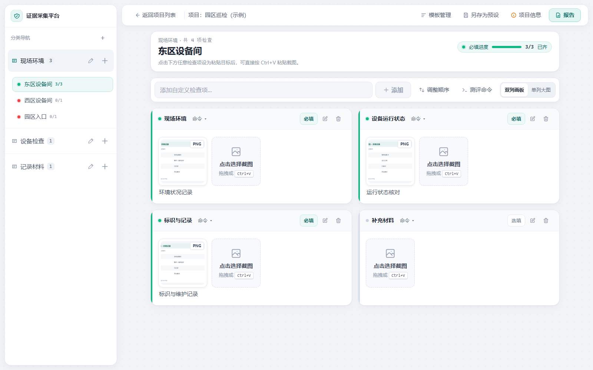

# 证据采集平台

把零散照片和截图整理成有条理的记录，再导出 Word 报告。适合巡检、验收、现场记录、测评取证等工作，无需注册账号。

项目以卡片分组展示，打开后按分类、采集对象与检查项收集图片。电脑上传、拖入或粘贴截图，也可以让手机在同一网络下拍照同步。分类、检查项和报告信息均可自定义，配置好后保存为预设，供后续项目或同事复用。

## 下载与启动

从 [最新版本](https://github.com/galact-byte/picture_ocr/releases/latest) 下载，改动说明见对应 Release 页面。

| 版本 | 启动方式 |
| --- | --- |
| Windows 桌面版 | 下载 `.exe`，直接打开。 |
| Web 版（Windows 启动） | 下载 `picture-ocr-vX.Y.Z.zip`，完整解压后双击 `启动证据采集工具.bat`，在自动打开的浏览器中使用。使用期间保持启动窗口打开。 |

发布包无需安装开发环境。升级前建议导出项目备份；升级 Web 版时沿用原来的浏览器和访问地址，页面未更新可按 `Ctrl+Shift+R` 强制刷新。

## 开始使用

1. **新建项目**：独立任务选“单系统”，需要集中管理多个任务时选“系统组”。界面中的“系统”和“资产”可以对应实际工作中的采集任务与对象。
2. **设置采集清单**：添加分类与采集对象，在“模板管理”中设置检查项，或直接为对象添加。默认使用通用模板，不限定行业。
3. **收集图片**：上传、拖入图片，或选中检查项后按 `Ctrl+V` 粘贴；填写图片备注，按需要切换“双列画板”和“单列大图”。
4. **手机拍照**：点击“手机局域网采集”，让手机和电脑连接同一 Wi-Fi 或热点，扫码后选择对应检查项拍照、选图。手机无需安装应用，采集时保持电脑端运行。
5. **导出报告**：在“项目信息”中填写报告标题等内容，点击“报告”导出 Word。缺少必填截图时会先提醒。

## 复用模板

在配置好的项目中点击“另存为预设”，保存分类、检查项和报告设置，作为之后新建项目的默认模板。也可导出预设文件，让同事通过项目列表的“模板预设”导入。

切换预设只影响新项目，已有项目保留自己的内容。预设不包含采集对象和图片，不能代替项目备份。

## 数据与备份

- 数据保存在本机，桌面版和 Web 版各自独立，不会自动同步。Web 版清理浏览器站点数据会删除项目，更换浏览器或访问地址也可能看不到原数据。
- 定期通过“导出数据包”保存 ZIP，在其他电脑或版本中通过“导入数据包”恢复。“覆盖导入”会替换目标内容，请先备份。
- 可以勾选多个系统批量导出；需要释放本机图片空间时，可在“存储设置”中归档，妥善保管归档文件。

## 使用文档

[使用指南](docs/user-guide.md)提供模板预设、手机采集、批量备份、归档与数据目录恢复的详细操作。需要设备核查命令的工作可选用其中的“测评命令”功能。

## 开发与构建

源码运行、构建和发布方式见 [开发与发布说明](docs/releasing.md)。只使用软件请下载上述发布包。

## 许可

个人与公司可免费用于合法内部工作，包括报告交付。对外售卖软件、集成进收费产品或提供以软件功能为直接收费内容的服务，须取得书面商业授权。

完整使用、分发与授权条件见 [LICENSE](LICENSE)，第三方声明见 [NOTICE](NOTICE)。本项目采用自定义源码可用许可，并非 MIT 或 OSI 开源许可。
